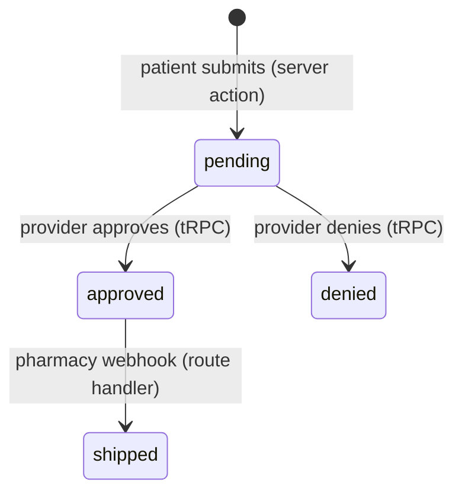

# Mini Rx

A small telehealth prescription workflow built with Next.js, tRPC and Drizzle.

1. A **patient** submits a prescription request.
2. A **provider** reviews the queue and **approves** or **denies** it.
3. A **pharmacy** calls a signed **webhook** when it ships an approved prescription, and the app marks it **shipped**.



No other transitions are allowed. Each rule is enforced inside the database `UPDATE` itself.

## Tech stack

- [Next.js 15](https://nextjs.org) (App Router: server components, server actions, route handlers)
- [tRPC v11](https://trpc.io) with [TanStack Query](https://tanstack.com/query)
- [Drizzle ORM](https://orm.drizzle.team) on SQLite ([libSQL](https://github.com/tursodatabase/libsql))
- [Zod](https://zod.dev) for validating all incoming data
- [Tailwind CSS v4](https://tailwindcss.com)
- TypeScript (strict), scaffolded with [create-t3-app](https://create.t3.gg)

## Getting started

Requires Node.js 20+.

```bash
npm install
cp .env.example .env
```

In `.env`, replace the placeholder webhook secret with a real one:

```bash
openssl rand -hex 32
```

Create the database table and start the dev server:

```bash
npm run db:push
npm run dev
```

Open [http://localhost:3000](http://localhost:3000). It redirects to the requests queue.

## Using the app

| Page | What it does |
|---|---|
| `/requests` | Queue of all requests, newest first, with counts for each status. Click any row to open it. |
| `/requests/new` | Intake form for a new request. |
| `/requests/[id]` | Request details. Pending requests show **Approve** / **Deny** buttons. |

### Simulating the pharmacy

The script below acts as the pharmacy. It signs the payload with your `PHARMACY_WEBHOOK_SECRET` and sends the webhook:

```bash
./scripts/simulate-pharmacy.sh <requestId>
```

Approve a request in the UI first, then run the script with its id:

```
{"ok":true,"status":"shipped"}
HTTP 200
```

## How it works

Each kind of data access uses the tool that fits it:

| Path | Tool | Where |
|---|---|---|
| Reading the queue and details | Async **server components** querying Drizzle directly | `src/app/requests/page.tsx`, `src/app/requests/[id]/page.tsx` |
| Submitting a request | **Server action** + `useActionState` | `src/app/requests/actions.ts`, `src/app/requests/new/page.tsx` |
| Approving / denying | **tRPC mutation** (`request.updateStatus`) | `src/server/api/routers/request.ts`, `src/app/requests/[id]/ReviewActions.tsx` |
| Pharmacy shipping updates | **Route handler** webhook | `src/app/api/webhooks/pharmacy/route.ts` |

### Design decisions

- **Validation at every boundary.** Form data, tRPC input and webhook payloads are all checked with Zod before anything touches the database.
- **Race-safe status changes.** Updates use `UPDATE ... WHERE id = ? AND status = <expected>` rather than reading first and writing after. If two providers act on the same request at once, only one update succeeds. The other gets a `409 CONFLICT`.
- **End-to-end types with tRPC.** The client imports only the router's *type*. If a procedure's name or input changes, the client stops compiling.
- **Secure, idempotent webhook.**
  - The pharmacy signs the raw request body with HMAC-SHA256 (`x-pharmacy-signature` header).
  - The signature is checked with `timingSafeEqual` before the body is parsed.
  - The handler rejects every call if no secret is configured.
  - Duplicate deliveries return `200` instead of an error, because webhook senders retry.
- **Fresh data after every write.** Each change calls `revalidatePath("/requests")` so the cached queue never shows a stale status.
- **Minimal client JavaScript.** Only components that need hooks are client components: the form, the review buttons and the navbar.
- **Accessibility.**
  - Table rows are fully clickable through a "stretched link". This keeps normal link behavior: keyboard navigation, Cmd-click and screen readers.
  - The navbar marks the current page with `aria-current`.
  - Every input has a label.

### Webhook reference

`POST /api/webhooks/pharmacy`

```json
{ "event": "prescription.shipped", "requestId": 3 }
```

| Status | Meaning |
|---|---|
| `200` | Marked shipped, or already shipped (`"duplicate": true`) |
| `400` | Invalid JSON or payload |
| `401` | Missing or invalid signature |
| `404` | Request not found |
| `409` | Request isn't approved, so it can't ship |
| `500` | `PHARMACY_WEBHOOK_SECRET` isn't configured |

## Project structure

```
src/
├── app/
│   ├── _components/NavBar.tsx        # navigation with active-link state
│   ├── api/
│   │   ├── trpc/[trpc]/route.ts      # tRPC HTTP endpoint
│   │   └── webhooks/pharmacy/route.ts
│   ├── requests/
│   │   ├── page.tsx                  # queue
│   │   ├── actions.ts                # createRequest server action
│   │   ├── new/page.tsx              # intake form
│   │   └── [id]/                     # detail page + approve/deny
│   └── layout.tsx
├── server/
│   ├── api/routers/request.ts        # tRPC router
│   └── db/schema.ts                  # Drizzle schema
└── env.js                            # validated environment variables
scripts/simulate-pharmacy.sh          # pretend pharmacy
```

## Scripts

| Command | Description |
|---|---|
| `npm run dev` | Start the dev server |
| `npm run build` / `npm start` | Production build and server |
| `npm run check` | Lint + type-check |
| `npm run db:push` | Sync the schema to the database |
| `npm run db:studio` | Browse the database in Drizzle Studio |

## Roadmap

This is a demo. Before handling real patient data, it would need:

- **Authentication and roles.** Replace `publicProcedure` with a `protectedProcedure` that checks for a provider role.
- **Audit trail.** Record who changed each status and when.
- **HIPAA safeguards.** Encryption, access logging and compliant hosting.
- **Webhook replay protection.** Sign a timestamp and reject old requests. Store event IDs for deduplication.
- **Tests.**
  - Router tests with tRPC's `createCaller`
  - A test for each of the webhook's status codes
  - A Playwright end-to-end test of the full flow
- **Pagination and status filters** on the queue.
